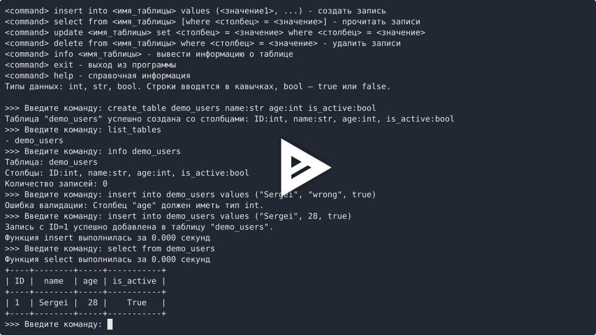

# Примитивная база данных

Учебный проект №2. Автор: Mushkarev, группа М26-555.
Репозиторий: `project-2_Mushkarev_M26-555`.

Консольное приложение для создания таблиц и работы с записями. Схемы
сохраняются в `db_meta.json`, данные — в `data/<имя_таблицы>.json`.
Приложение использует функции, словари, списки, JSON, декораторы и замыкание.

## Установка и запуск

Требуются Python 3.12 или новее и uv 0.5 или новее.

```bash
uv sync
uv run database
```

Также доступны `uv run project`, `uv run python -m primitive_db.main`
и команды Make:

```bash
make install
make run
make lint
make build
```

Сборка и проверка метаданных без публикации:

```bash
uv build
uvx twine check dist/*
```

Установка собранного пакета как самостоятельного инструмента:

```bash
uv tool install dist/*.whl
database
```

Файлы базы создаются в текущей рабочей директории. Для отдельной базы
запускайте `database` из отдельного каталога.

## Управление таблицами

```text
create_table users name:str age:int is_active:bool
list_tables
info users
drop_table users
```

Поддерживаются типы `int`, `str`, `bool`. Столбец `ID:int` добавляется первым
автоматически. Его значение задаётся приложением. Повторные имена столбцов,
неподдерживаемые типы, существующая таблица и отсутствие таблицы проверяются.

## CRUD-операции

```text
insert into users values ("Sergei", 28, true)
select from users
select from users where age = 28
update users set age = 29 where name = "Sergei"
delete from users where ID = 1
```

Все поля обязательны. При вставке ID не передаётся. Новый ID равен
максимальному ID среди текущих записей плюс один. Строки заключаются
в одинарные или двойные кавычки; пробелы, запятые и знаки `=` внутри строки
сохраняются. Логические значения записываются как `true` и `false`.
Числа и логические значения не подменяют друг друга при проверке типов.

В `set` можно изменить несколько полей через запятую:

```text
update users set age = 30, is_active = false where ID = 1
```

Результат `select` выводится через PrettyTable. Для справки введите `help`,
для выхода — `exit`. Некорректная команда не завершает программу.

## Декораторы и кэширование

`handle_db_errors` обрабатывает ожидаемые ошибки файлов, таблиц, столбцов
и значений. `confirm_action` перед удалением записей или таблицы запрашивает
подтверждение `[y/n]`. Операция выполняется только после `y`.
`log_time` выводит время выполнения `insert` и `select` с точностью
до трёх знаков после запятой.

`create_cacher()` хранит результаты выборок в замыкании. Повторный запрос
использует кэш. Изменения данных сбрасывают кэш, а возвращаемые записи
копируются, чтобы последующее изменение результата не повредило кэш.

## Структура

```text
src/primitive_db/
    __init__.py
    main.py
    engine.py
    core.py
    utils.py
    parser.py
    decorators.py
    constants.py
```

`main.py` — точка входа, `engine.py` — цикл и вызовы команд,
`core.py` — операции с таблицами и записями, `utils.py` — файловые операции,
`parser.py` — разбор команд, `decorators.py` — декораторы и замыкание,
`constants.py` — неизменяемые настройки.

## Демонстрация

[](https://asciinema.org/a/TA08eVv2cFdtpy1H)

Запись показывает установку пакета и запуск, создание таблицы, все
CRUD-операции, отмену и подтверждение удаления записей и таблицы.

Исходный файл записи находится в репозитории: [demo.cast](demo.cast).
Его можно скачать и посмотреть локально через asciinema 3 или новее:

```bash
asciinema play demo.cast
```
